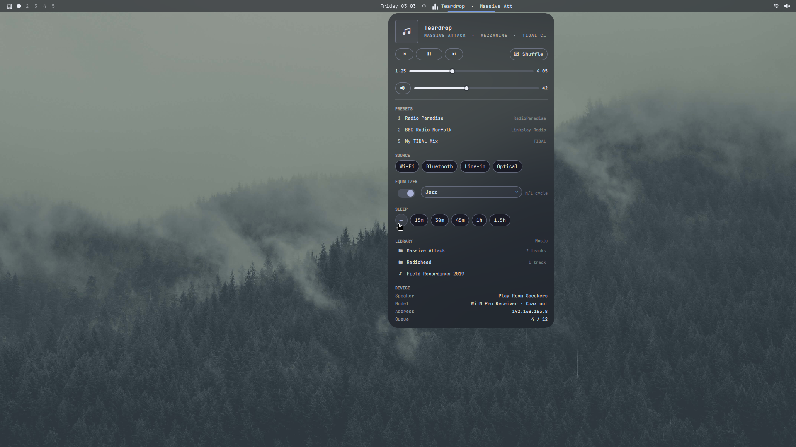
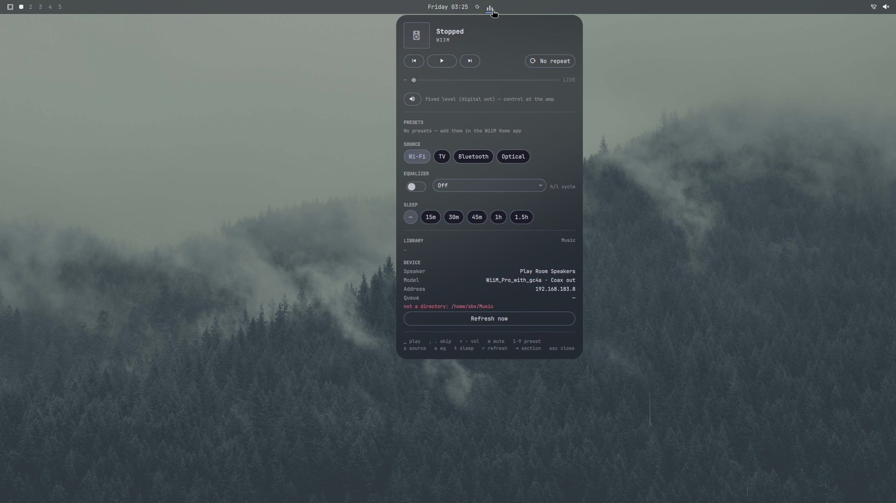

# ric.wiim — WiiM controller for the Omarchy shell

A native Omarchy 4 (Quattro) bar widget + companion CLI for WiiM / Linkplay
streaming players. One chip in the bar, one panel for everything: transport,
progress, volume, presets, sources, EQ, sleep timer, and your local music
library — fully keyboard-driven.



*Fixture view (deterministic demo data). The same panel against a real
WiiM Pro Receiver, stopped and idle:*



## Why

The WiiM Home app is phone-first and the official remote APIs are raw
HTTP/XML. This plugin wraps them in the Omarchy shell's own design language
(shared theme tokens, cursor model, tooltips) and keeps all device I/O in a
small Python daemon outside the shell, so the panel stays instant and the
state survives panel open/close.

## Install

Requires Omarchy 4.0.0.alpha ("Quattro") hosted shell.

```sh
# from a checkout of this repository:
ln -s ~/Work/wiim ~/.config/omarchy/plugins/ric.wiim
# (or git clone this repo straight into that path)
```

Add the widget to a bar section in `~/.config/omarchy/shell.json`, e.g.
after `chriopter.brumm` in `bar.layout.center`:

```json
{ "id": "ric.wiim" }
```

Then `omarchy-restart-shell`. No other dependencies: the CLI is a single
Python 3 file (`bin/wiim`, stdlib only) and the widget spawns it.

Optionally put the CLI on your PATH for shell/keyboard use:

```sh
ln -s ~/.config/omarchy/plugins/ric.wiim/bin/wiim ~/.local/bin/wiim
wiim config set ip 192.168.183.8     # pin your zone (skip to auto-discover)
```

## Device discovery & pinning

`wiim discover` (mDNS via avahi) finds zones on the LAN; the widget's
`deviceIp` setting pins one. With no pin, the CLI picks the first discovered
zone. Pin yours in the plugin settings (below) or `wiim config set ip …`.

## Widget settings

Per-entry settings in `shell.json` (all optional):

```json
{ "id": "ric.wiim", "deviceIp": "192.168.183.8", "musicDir": "~/Music",
  "volStep": 5, "pollMs": 500, "barText": true, "fixture": false }
```

| key        | default          | meaning                                        |
|------------|------------------|------------------------------------------------|
| `deviceIp` | `192.168.183.8`  | pinned zone IP; empty ⇒ auto-discover          |
| `musicDir` | `~/Music`        | local library root served to the device        |
| `volStep`  | `5`              | volume delta for `+`/`−` and the wheel         |
| `pollMs`   | `500`            | device poll rate (full refresh every 15 s)     |
| `barText`  | `true`           | show now-playing text next to the bar mark     |
| `fixture`  | `false`          | deterministic demo data, no device touched     |

## Using it

- **Left-click** the bar mark → panel. **Middle-click** → play/pause.
  **Scroll wheel** over the chip → volume.
- The bar mark is an equalizer: dim = idle, bright = paused, animated =
  playing, speaker glyph = offline. With `barText` it shows
  `Title · Artist` (glides when long, brumm-style).
- Open the panel from anywhere with IPC:
  `omarchy-shell ric.wiim toggle` — bind it if you like:
  `o.bind("SUPER + M", nil, "omarchy-shell ric.wiim toggle")`
  (added to `~/.config/hypr/bindings.lua`, then `hyprctl reload`).

### Keyboard model

The panel is a single cursor over sections (`⇥`/`⇧⇥` cycle, `j`/`k` move
within lists, `h`/`l` adjust sliders/chips). `⏎` activates the focused
section; `␣` always play/pauses. Direct keys never move the cursor:

| key         | action                    | key        | action                 |
|-------------|---------------------------|------------|------------------------|
| `␣`         | play / pause              | `m`        | mute                   |
| `,` `.`     | previous / next           | `1`–`9`,`0`| preset 1–9, 10         |
| `+` `=`     | volume up                 | `s`        | next source            |
| `-` `_`     | volume down               | `e`        | cycle EQ on/off        |
| `t`         | cycle sleep timer         | `r`        | refresh                |
| `u`         | library up one dir        | `esc`      | close (popup first)    |

## Media keys (smart routing)

The companion CLI routes hardware media keys to the WiiM zone when it is
the active source, and to MPRIS players otherwise:

```lua
-- ~/.config/hypr/bindings.lua
hl.unbind("XF86AudioPlay"); hl.unbind("XF86AudioPause")
hl.unbind("XF86AudioNext"); hl.unbind("XF86AudioPrev")
o.bind("XF86AudioPlay",  "Play/pause (WiiM smart)", "wiim media playPause", { locked = true })
o.bind("XF86AudioPause", "Play/pause (WiiM smart)", "wiim media playPause", { locked = true })
o.bind("XF86AudioNext",  "Next (WiiM smart)",       "wiim media next",      { locked = true })
o.bind("XF86AudioPrev",  "Previous (WiiM smart)",   "wiim media previous",  { locked = true })
```

This is exactly what ships in this repo's install; remove those lines to
return to Omarchy defaults.

## Local library streaming

The panel browses `musicDir` (folders → audio files) and streams selections
to the device over HTTP: the daemon embeds a small read-only server bound to
that directory and hands the device a direct URL. Tidal, radio presets and
Bluetooth keep working through the device itself — the library is just one
more source of audio.

**Network caveat:** some access points enable *client isolation*, which
blocks the device from reaching your machine's LAN HTTP server. The device
then sits stuck in `load` and the panel says so
(*"Stream not starting — device cannot reach the music server (AP client
isolation?)"*). On a normal LAN (or with the host wired to the same segment)
this works end-to-end. Public stream URLs (`wiim play-url`) are unaffected.

## Known device quirks (verified on WiiM Pro Receiver, coax out)

- **Fixed volume on digital outputs.** Optical/coax outputs pass a fixed
  line level: volume writes are accepted but ignored. The panel detects the
  output mode and replaces the slider with *"fixed level (digital out) —
  control at the amp"*. Mute still works.
- **EQ status readback** (`EQGetStat`) is unsupported on some firmware; the
  EQ section then shows the last state you set.
- **Presets** are whatever you saved in the WiiM Home app; the panel lists
  them read-only.
- Never confuse the **sleep timer** with the shutdown timer — the CLI only
  ever sets `setShutdown:1` (sleep) or `-1` (off), never `0`.

## CLI reference

```
wiim [--ip IP] [--config PATH] [--timeout S] <command>

discover                 list zones (mDNS)
status [--fast]          JSON snapshot (--fast: player+meta only)
play|pause|play-pause|stop|next|previous
vol [N]                  get/set volume            mute [0|1]
preset N                 play a WiiM Home preset
source <wifi|bluetooth|optical|linein|tv|…>
eq <name|off>            apply built-in EQ preset
seek N                   jump to ms                loop <none|all|one|shuffle>
sleep [SEC]              sleep timer (no arg = show; -1 = off)
play-url URL [TITLE]     stream an arbitrary URL
library [PATH]           list musicDir tree        album PATH     list a folder
serve [--port N] [--dir D]   standalone library HTTP server
daemon [--dir D] [--interval S]  watch+serve+stdin commands (used by widget)
media [--prefer auto|wiim|mpris] ACTION   smart media-key router
config show|set KEY VAL  ~/.config/wiim/config.json (ip, musicDir)
```

Exit codes: `0` ok, `1` device error, `2` usage, `3` offline/no zone.

## Development

```sh
python3 -m unittest discover -s tests   # CLI + fixture-server protocol tests
node tests/test_model.js                # pure view-model tests
qmllint -I <qsimports> BarWidget.qml    # QML static check
```

GUI work happens in an `omabox` box:
`omabox up --plugin ~/Work/wiim`, set `"fixture": true` in the box's
`shell.json`, `omabox restart-shell`, `omabox shot`. Set `fixture:false`
to drive the real device from inside the box.

## Layout of this repo

```
manifest.json     Quattro plugin manifest (bar-widget entry point)
BarWidget.qml     chip + panel (hosted Ui.KeyboardPanel, cursor model)
Model.js          pure view-model: formatting, state mapping, options
bin/wiim          CLI + daemon + library server (Python 3, stdlib only)
tests/            unittest suite + fixture device server + node model tests
docs/           DESIGN.md (design rationale) + captured API notes
```

MIT licensed. Not affiliated with Linkplay Computing.
